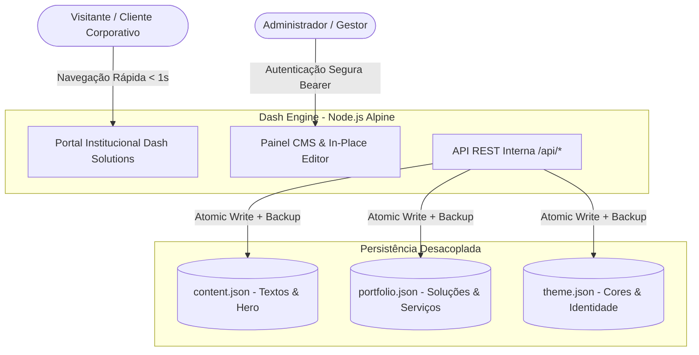

# Dash Solutions — Apresentação Executiva e Técnica da Plataforma

---

## 1. Sumário Executivo

A **Dash Solutions** é uma plataforma corporativa integrada de alta performance que une um **Portal Institucional de Vanguarda** a um **Sistema de Gestão de Conteúdo (CMS) Proprietário de Baixa Latência**.

Concebida sob os princípios da engenharia de software moderna, a plataforma foi desenvolvida para atender organizações que exigem autoridade de marca, flexibilidade editorial imediata e máxima segurança, sem a sobrecarga, custos e vulnerabilidades crônicas dos CMS tradicionais do mercado (como WordPress, Drupal ou Joomla).



---

## 2. Proposta de Valor e Diferenciais

| Pilar | Abordagem Tradicional (WordPress / CMS Pesados) | Abordagem Dash Solutions |
| :--- | :--- | :--- |
| **Performance (TTFB & LCP)** | 2.5s a 5.0s devido a plugins e banco relacional | **< 400ms** com renderização nativa direta |
| **Vulnerabilidades de Segurança** | Alta superfície de ataque (SQL Injection, exploits de plugins PHP) | **Superfície mínima** (Sem banco relacional suscetível a SQLi, sem dependências vulneráveis) |
| **Manutenção e Atualizações** | Constante quebra de plugins e necessidade de patches | **Imutável e conteinerizada**, zero manutenção de dependências externas |
| **Autonomia de Gestão** | Painéis complexos, confusos e distantes da interface visual | **Gestão in-place (direto na página)** e Drawer gerencial intuitivo |
| **Custo de Infraestrutura** | Servidores dedicados caros para aguentar concorrência | **Pegada levíssima (< 50MB RAM)**, viabilizando execução serverless a custo quase zero |

---

## 3. Identidade Visual e Experiência do Usuário (Design System)

A estética da Dash Solutions segue o padrão visual corporativo de alta autoridade inspirado na **G4 Business**, combinando sobriedade executiva, elegância tipográfica e micro-interações fluidas.

- **Paleta Cromática Nobre:**
  - `bgMain`: Azul Marinho Nobre Profundo (`#001F35`)
  - `bgDeep`: Marinho Abissal de Contraste (`#01121E`)
  - `bgSurface`: Superfície de Cards e Módulos (`#06263F`)
  - `primaryColor`: Dourado Champagne Metálico (`#B9915B`)
  - `secondaryColor`: Ouro Suave para Destaques (`#C9A96E`)
- **Tipografia:** Hierarquia refinada utilizando fontes corporativas modernas sem serifa para legibilidade (`Inter / Outfit`) associadas a toques em *serifa itálica clássica* para títulos de destaque institucional.
- **Micro-interações:** Efeitos de elevação suave em cards, transições suaves de tema via CSS Custom Variables e carrossel dinâmico com auto-play suave.

---

## 4. Funcionalidades do Portal Público

1. **Header e Barra de Anúncios Dinâmica:**
   - Badge exclusivo e chamadas estratégicas com link direto para agendamento técnico.
   - Identidade visual configurável (Monograma corporativo ou logotipo em imagem de alta definição).
   - Navegação ancorada instantânea e botão de conversão rápida (*CTA*).

2. **Hero Section de Alto Impacto:**
   - Chamada executiva com suporte a títulos estilizados em serifa itálica.
   - **Carrossel Corporativo Multimídia:** rotação automática configurável, suporte a imagens do catálogo interno, links externos ou upload local.
   - Badges de autoridade integrados: *SLA Corporativo 24/7*, *Conformidade ISO & LGPD* e *Metodologia Ágil & ITIL 4*.

3. **Métricas de Autoridade:**
   - 4 indicadores quantitativos de impacto com animação de contagem (Uptime, Gestão Sob Medida, Anos de Mercado, Horas de Sustentação).

4. **Portfólio de Soluções com Filtros Inteligentes:**
   - Categorização por segmentos estratégicos:
     - **Software & IA:** Aplicações sob medida, esteiras de IA generativa corporativa e RAG privado.
     - **Infraestrutura & Cloud:** Arquitetura multicloud, migração e sustentação contínua.
     - **Cibersegurança & Compliance:** Defesa ativa, pentest e conformidade LGPD.
   - Modal com detalhamento técnico completo de cada serviço: entregáveis, arquitetura, stack tecnológica e diferenciais.

5. **Seção Institucional ("Sobre Nós") & Pilares Estratégicos:**
   - Manifesto corporativo com citação de liderança.
   - 3 Pilares Fundamentais: *Excelência Técnica*, *Governança Rigorosa* e *Foco em Resultados*.
   - Mosaico do Ecossistema Tecnológico parceiro.

6. **Framework & Metodologia de Entrega:**
   - Processo em 4 etapas estruturadas:
     1. *Diagnóstico & Mapeamento*
     2. *Arquitetura & Desenho de Solução*
     3. *Implantação & Testes Rigorosos*
     4. *Sustentação & Otimização Contínua 24/7*

7. **Canal de Contato & Conversão Corporativa:**
   - Formulário com validação em tempo real e integração direta com canais de atendimento e WhatsApp institucional.

---

## 5. Sistema de Gestão de Conteúdo (CMS Integrado)

A plataforma possui um sistema de administração nativo acessível diretamente pela interface sem redirecionamentos externos lentos.

### 5.1. Mecanismo de Acesso e Segurança
- **Ponto de Entrada:** Botão **"Gestão"** no cabeçalho ou link **"🔒 Área do Administrador"** no rodapé.
- **Autenticação:** Validação com chave administrativa segura via cabeçalho `x-admin-token`.
- **Barra de Gestão Ativa:** Ao autenticar, uma barra fixa no topo da tela oferece atalhos para todos os módulos administrativos, contagem de itens e alternância de modo.

### 5.2. Modalidades de Edição
- **Edição In-Place (Visual Direta):** Cada card do portfólio e cada seção ganha controles visuais de `[ Editar ]` e `[ Excluir ]` em tempo real.
- **Painel Gerencial Drawer (Lateral Unificado):**
  - **Aba 1 (Portfólio):** Tabela de soluções com criação, ordenação, troca de ícones, tecnologias e detalhamento.
  - **Aba 2 (Carrossel do Banner):** Gerenciador de slides com upload direto de arquivos, URLs e tempos de rotação.
  - **Aba 3 (Métricas & Indicadores):** Edição dos valores, legendas e descrições das métricas de impacto.
  - **Aba 4 (Sobre Nós & Pilares):** Gestão do texto do manifesto, frases de destaque e pilares de engenharia.
  - **Aba 5 (Framework & Metodologia):** Customização dos passos da esteira de entrega corporativa.
  - **Aba 6 (Identidade & Contato):** Edição de logotipo, telefones, e-mails corporativos, endereço físico e rodapé.
  - **Aba 7 (Estúdio de Cores & Temas):** Seletor de temas (presets corporativos e customização fina de HEX com proteção contra cores que comprometam a legibilidade).
  - **Aba 8 (Backup & Recuperação de Desastres):** Download instantâneo de snapshot JSON completo, restauração de arquivos e redefinição de fábrica.

---

## 6. Arquitetura Técnica e Especificações

```
dashsolutions/
├── server.js              # Servidor HTTP Node.js puro, seguro e de alta performance
├── index.html             # Marcação semântica, SEO integrado e estruturas modais
├── style.css              # Design system corporativo modular em CSS nativo
├── script.js              # Lógica do portal, renderização dinâmica e motor do CMS
├── content.json           # Banco de dados de conteúdo estruturado
├── portfolio.json         # Catálogo de soluções e capacidades técnicas
├── theme.json             # Definições de tokens cromáticos ativos
├── Dockerfile             # Containerização minimalista em Node Alpine (tamanho < 150MB)
├── docker-compose.yml     # Orquestração local/servidor com volumes mapeados
└── nginx.conf             # Configuração otimizada para proxy reverso de borda
```

### 6.1. Características de Engenharia
- **Zero Frameworks Pesados no Front-end:** Utiliza JavaScript moderno (ES6+) e CSS nativo com variáveis customizadas. Isso garante compatibilidade com qualquer navegador corporativo, sem riscos de quebras por descontinuidade de bibliotecas de terceiros.
- **Backend Node.js Minimalista:** O `server.js` opera apenas com os módulos nativos do Node.js (`http`, `fs`, `path`). Nenhum pacote npm externo é obrigatório no runtime, reduzindo a zero a ocorrência de avisos de segurança no `npm audit`.
- **Persistência Atômica com Salvaguarda Automática:** Ao salvar qualquer alteração pelo CMS, o backend executa uma cópia de segurança automática com extensão `.bak` antes de persistir o novo JSON, garantindo integridade contra falhas de escrita.
- **Validação e Higienização de Payloads:** Proteção contra injeção de scripts, verificação de tamanho máximo de payload por requisição e filtros contra dados maliciosos.

---

## 7. Conclusão e Próximos Passos

A **Dash Solutions** entrega uma solução corporativa definitiva: alia estética digna das maiores consultorias e empresas de tecnologia globais à simplicidade operacional e segurança de código proprietário.

Para orientações sobre a arquitetura de nuvem, publicação e esteira de CI/CD em ambiente corporativo, consulte o documento:
👉 **[Guia de Implantação no Google Cloud (GCP)](file:///c:/Users/cvalois/Documents/Antigravity/dashsolutions/GUIA_IMPLANTACAO_GOOGLE_CLOUD.md)**.
